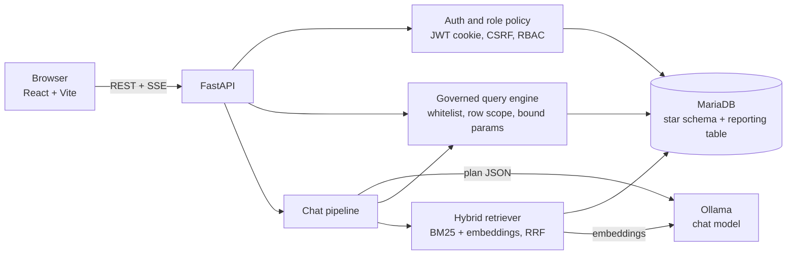

# Business Analytics

A reporting and analytics web app for e-commerce sales data, with role-based access control and an AI analyst that answers questions in plain English using retrieval-augmented generation (RAG).

Everything runs **locally**: no cloud services, no API keys, and no data leaves the machine. The AI runs on a local model through [Ollama](https://ollama.com).

> Built as a take-home assessment for a reporting-and-analytics role. The sales dataset used during development is confidential and **is not included in this repository** (see [Bringing your own data](#bringing-your-own-data)).

---

## Highlights

- **Dashboards and reports** with KPI cards, trends, a 6-month forecast, geography, seasonality heatmap, product, customer and fulfilment reports, and a side-by-side compare tool.
- **AI analyst (local RAG):** ask a question in plain English and get an answer with a *How I got this* panel showing the plan, the SQL that ran, and the sources used.
- **Role-based access enforced on the server:** row-level and column-level security per role, with five roles and a tamper-evident audit log.
- **A real database design:** star schema in MariaDB with foreign keys, CHECK constraints, versioned migrations and least-privilege accounts.
- **Tested:** about 220 automated checks across security, the database, chat accuracy and the frontend.

## Screens and features

| Area | What it does |
|---|---|
| **Dashboard** | KPI cards with sparklines and year-on-year change, auto-generated insights, trend, year-over-year, forecast, category mix, click-to-cross-filter geography, top products, discount-vs-profit, seasonality heatmap, delivery by region, shipping, order status, returns, segments, payment methods, personal targets |
| **Products** | Sub-category performance, Pareto concentration, most and least profitable, highest return rates, searchable leaderboard |
| **Customers** | Repeat rate, new vs returning, order-frequency distribution, concentration, top customers, segments |
| **Fulfilment** | Delivery time by lane, delivery bands, shipping speed vs cost, returns and cancellations, slowest lanes |
| **Compare** | Any two regions, categories, years, segments or shipping methods head to head |
| **Orders** | Searchable, sortable, paged order list with CSV export (audited) |
| **AI Analyst** | Local RAG chat with follow-up questions, record lookup (`ORD-…`, `CUST-…`), inline charts and tables, saved history, feedback |
| **Admin** | User management, access policy, database overview, audit log with integrity check, system health |
| **Definitions** | How net vs gross revenue works, every metric explained, known data caveats |
| **Output** | Print / Save as PDF report, CSV download on every chart and table, all filters stored in the URL so views are shareable |

## Architecture



### How the AI analyst works

1. **Guard:** off-topic input and prompt-injection attempts are refused before any model runs.
2. **Plan:** the local model turns the question into a small JSON plan (metric, grouping, filters). The schema only allows metrics the user's role may see.
3. **Two lookups:**
   - *Numbers:* the plan runs as a governed SQL query. **The model never writes SQL**, so figures are exact.
   - *Context:* hybrid search (BM25 keywords + vector embeddings, merged with Reciprocal Rank Fusion) over a knowledge base of pre-computed fact sheets. Documents outside the user's role are filtered out **before** ranking.
4. **Answer:** the model explains the numbers it was given and is instructed not to invent any.
5. **Proof:** a *How I got this* panel shows the plan, the SQL and the sources.

If Ollama is not running, the app still works and the chat falls back to a plain data-readout mode.

### Database

A **star schema** is the source of truth, and a flat reporting table is the fast copy the app reads.

- `fact_orders` plus seven dimensions: customer, product, geography, date, order status, shipping method and payment method.
- 10 foreign keys and 11 CHECK rules (for example discount between 0 and 100%, revenue equals price x quantity x (1 - discount)).
- `orders`: a denormalised reporting table rebuilt from the star schema, so dashboard queries need no joins.
- Application tables: users, sessions, login attempts, audit log, chat messages, knowledge-base documents, targets, schema migrations.
- Versioned, checksummed SQL migrations in `backend/migrations/`.
- Two accounts: `panorama_app` for the web app (reads reporting data, writes only its own tables, audit log is insert-only) and `panorama_owner` for migrations and loading.

## Tech stack

| Layer | Technology |
|---|---|
| Backend | Python 3.11, FastAPI, Pydantic, PyMySQL, pandas, bcrypt, PyJWT, httpx |
| Database | MariaDB 10.4 (XAMPP) |
| Frontend | React 19, Vite, Tailwind CSS 4, Recharts, framer-motion, react-router |
| AI | Ollama with `qwen2.5:7b` (chat) and `nomic-embed-text` (embeddings) |
| Testing | Custom HTTP and database test suites, a chat evaluation harness, Vitest |

## Roles

Access is enforced **on the server**. Hiding things in the UI is only a convenience.

| Role | Rows | Hidden columns | Notes |
|---|---|---|---|
| Administrator | all | none | plus users, audit log, database overview |
| Executive | all | customer ids | landing page: dashboard |
| Regional Manager | own region only | none | one account per region |
| Category Manager | own category only | customer ids | one account per category |
| Operations | all | pricing, cost, profit, customer ids | landing page: fulfilment |

## Getting started

### Prerequisites

- Windows with [XAMPP](https://www.apachefriends.org/) (for MariaDB). The scripts assume `D:\IDE\xampp`; set `XAMPP_DIR` to change it.
- Python 3.11+
- Node.js 20+
- [Ollama](https://ollama.com) (optional but recommended, for the AI analyst)

### 1. Install

```bash
# backend
cd backend
python -m venv .venv
.venv\Scripts\python -m pip install -r requirements.txt

# frontend
cd ..\frontend
npm install
npm run build
```

### 2. Add your data

Place a sales CSV at the path configured by `CSV_PATH` in `backend/app/config.py` (or set the `CSV_PATH` environment variable). See [Bringing your own data](#bringing-your-own-data) for the expected columns.

### 3. Set up the database and AI knowledge base

Start MariaDB (XAMPP control panel, or let `start.bat` do it), then:

```bash
cd backend
.venv\Scripts\python -m app.bootstrap_db   # creates the database and accounts, runs migrations, loads the CSV, seeds demo users
.venv\Scripts\python -m app.rag            # builds the AI knowledge base (needs Ollama for embeddings; works without)
```

Passwords for the database accounts are generated into `backend/.env`. That file is git-ignored.

### 4. Enable the local AI (optional)

```powershell
powershell -ExecutionPolicy Bypass -File setup_ollama.ps1
```

### 5. Run

```bash
start.bat
```

The API and the UI are served together at **http://localhost:8000**. API documentation is at `/docs`.

For development with hot reload:

```bash
cd backend  && .venv\Scripts\python -m uvicorn app.main:app --reload
cd frontend && npm run dev          # http://localhost:5173, proxies /api
```

## Bringing your own data

The dataset is not part of this repository. The loader (`backend/app/ingest.py`) expects a CSV with these 26 columns:

```
Order_ID, Order_Date (MM/DD/YYYY), Year, Month, Quarter, Season, Customer_ID, Customer_Gender,
Customer_Segment, Region, Country, Category, Sub_Category, Product_Name, Unit_Price, Quantity,
Discount, Revenue, Cost, Profit, Profit_Margin_%, Shipping_Cost, Shipping_Method, Shipping_Days,
Payment_Method, Order_Status
```

Order statuses are `Delivered`, `Processing`, `Returned`, `Cancelled`. Returned and cancelled orders are excluded from **net** revenue. This rule is stored in the database (`dim_order_status.is_net`). Loading fails loudly if the data breaks a database constraint, for example revenue that does not equal price x quantity x (1 - discount).

Some automated tests and the chat evaluation compare results against the original CSV, so they need the same file to pass.

## Demo accounts

For local demos only. Turn them off with `DEMO_MODE=0` in `backend/.env`, which also hides them on the login screen.

| Username | Password | Role |
|---|---|---|
| `admin` | `admin123` | Administrator |
| `executive` | `exec123` | Executive |
| `asia.manager`, `europe.manager`, `me.manager`, `na.manager` | `manager123` | Regional Manager |
| `electronics.manager`, `clothing.manager`, `home.manager` | `category123` | Category Manager |
| `ops` | `ops123` | Operations |

## API

30 REST endpoints in `backend/app/main.py`, documented interactively at `/docs`. A ready-made [Postman collection](Panorama.postman_collection.json) covers 23 of them: run the **Log in** folder first, then the rest.

| Group | Endpoints |
|---|---|
| Auth | login, logout, change password, me, demo accounts |
| Analytics | meta, query, KPIs, insights, customers, forecast |
| Targets | list, set, delete |
| Orders | list, export, export event |
| Chat | stream (Server-Sent Events), history, delete history, feedback |
| Admin | audit log, audit verify, users (list, create, edit, reset password), system, database |
| Health | health |

## Security

- Passwords hashed with bcrypt; sessions are JWTs in an `httpOnly`, `SameSite=Strict` cookie, with the session id stored server-side so it can be revoked.
- CSRF header required on cookie-authenticated writes; 60-minute idle timeout and 8-hour absolute lifetime.
- Persisted login lockout (5 failures in 5 minutes).
- Server-side row and column security for every role, including in the AI chat, retrieval and the query cache.
- Every query is built from a whitelist of metrics and dimensions with bound parameters. The AI never writes SQL.
- Tamper-evident audit log (each entry stores the hash of the previous one) with a verify endpoint.
- Least-privilege database accounts.

## Testing

Run from `backend/` unless noted:

| Command | What it checks |
|---|---|
| `python -m tests.test_database` | 57 checks: schema, foreign keys, CHECK rules, constraint enforcement, privileges, migrations, reporting table consistency, concurrent audit writes |
| `python -m tests.test_security` | 99 checks over the real HTTP API: cookies and CSRF, session revocation, forged tokens, lockout, row and column security per role, SQL injection, cache and RAG isolation |
| `python -m tests.eval_chat` | 40 chat cases with golden answers computed independently with pandas: accuracy, follow-ups, lookups, refusals, prompt injection |
| `npm test` (in `frontend/`) | 27 unit and component tests |
| `python -m tests.bench` | latency measurements |

## Project structure

```
panorama-app/
├── backend/
│   ├── app/
│   │   ├── main.py              # API endpoints
│   │   ├── security.py          # auth, sessions, role policy
│   │   ├── engine.py            # governed query engine, KPIs, insights
│   │   ├── analytics_extra.py   # customers, forecast, targets, record lookup
│   │   ├── chat.py              # chat pipeline: guard, plan, lookup, answer
│   │   ├── rag.py               # hybrid retrieval (BM25 + embeddings + RRF)
│   │   ├── docs.py              # builds the knowledge-base fact sheets
│   │   ├── llm.py               # Ollama client
│   │   ├── db.py                # MariaDB connection and pool
│   │   ├── ingest.py            # CSV -> star schema -> reporting table
│   │   ├── audit.py             # hash-chained audit log
│   │   ├── migrate.py           # versioned migrations
│   │   ├── bootstrap_db.py      # one-time database setup
│   │   └── backup.py            # mysqldump backup and restore
│   ├── migrations/              # versioned SQL schema
│   └── tests/
├── frontend/src/
│   ├── pages/                   # Dashboard, Products, Customers, Fulfilment, Compare, Orders, Analyst, Admin, ...
│   ├── components/              # charts, layout, filters, background
│   └── lib/                     # API client, auth, filters, formatting
├── db_demo.sql / db_demo.bat    # guided tour of the database
├── open_phpmyadmin.bat
├── start.bat
└── setup_ollama.ps1
```

## Design decisions and known limits

- **Numbers come from SQL, words come from the model.** This is why the AI cannot invent figures.
- **Star schema plus a flat copy:** integrity from the first, speed from the second, at the cost of a rebuild step when data changes.
- **Net revenue is the default**, since returned and cancelled orders are not money the business kept.
- **Local model:** private and free, but slower and less capable than hosted models.
- **Scale:** designed for a single machine. For more users, move the query cache to Redis, run several API instances behind a load balancer (sessions are already stored in the database), and add read replicas. PostgreSQL would be the next step for larger analytical loads.
- The forecast is a simple projection and is labelled as an estimate.
- Recent months in the source data can be incomplete, and the app flags this instead of presenting it as a real decline.

## Possible next steps

Live data connection instead of a file, scheduled and emailed reports, alerts on unusual changes, Docker packaging, and incremental refresh of the reporting table.
